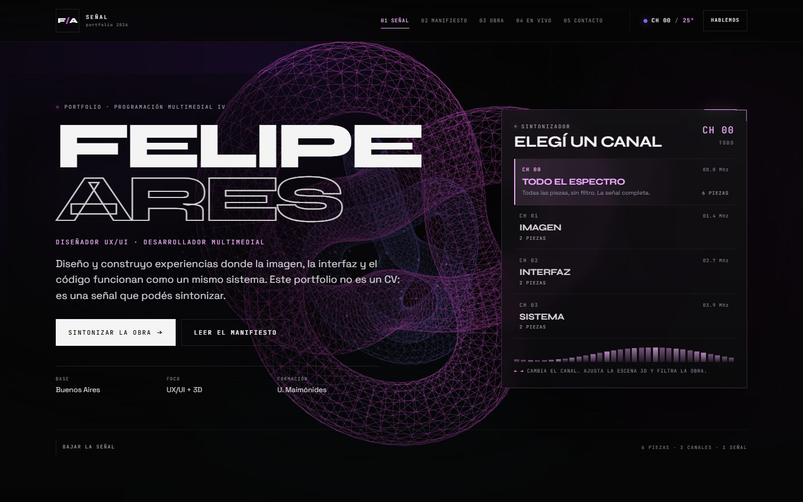

# PROCESO — Portfolio 2026, Felipe Ares

Documento de trabajo del proyecto final de **Programación Multimedial IV**. Registra el problema, las alternativas que se evaluaron, cómo evolucionó la pieza, qué se probó, qué dificultades aparecieron y qué queda pendiente.

- **Autor:** Felipe Ares
- **Pieza:** Portfolio 2026 — sitio interactivo
- **Stack:** Astro 6, React 19, Three.js / React Three Fiber, nanostores
- **Fecha de cierre de esta versión:** noviembre de 2026
- **Documentación de uso:** [README.md](README.md)

---

## 1. El problema

El punto de partida era un portfolio anterior hecho en Next.js. Funcionaba, pero tenía tres problemas para una entrega de esta materia:

1. **La interacción no demostraba el perfil.** El sitio mostraba piezas y un CV, pero no permitía experimentar el cruce entre diseño, interfaz y código que el perfil declara.
2. **El costo técnico no estaba justificado.** Next cargaba React para todo el sitio, incluso para secciones que solo mostraban texto. La escena 3D era el único motivo real de JavaScript en el cliente.
3. **La identidad visual estaba mezclada con decisiones de plantilla.** Había imágenes de stock, un toggle bilingüe y patrones de UI que no aportaban al concepto.

El encargo pedía, además, una API externa con estados reales, componentes con lógica propia, responsive, accesibilidad y documentación defendible. La pregunta de diseño fue: **¿cómo hacer que la navegación sea la demostración?**

### La hipótesis

Si el portfolio se comporta como un **entorno que se sintoniza**, el visitante puede elegir canales y ver el mismo estado reflejado en la escena 3D, en el archivo de obra y en la cabecera. Ese gesto único reemplaza el “menú + grilla” tradicional y convierte la exploración en la pieza.

---

## 2. Lectura del portfolio anterior

Antes de escribir código se auditó el proyecto `felipe-portfolio-next`:

| Elemento | Decisión |
|---|---|
| Paleta negro/violeta/fucsia, tipografía display | **Se conserva** como base de identidad. |
| Escena de torus knot con partículas | **Se migra y amplía** con geometría por canal. |
| Datos personales, experiencia, educación, contacto | **Se conservan** y se tipan en `profile.ts`. |
| Proyectos y textos | **Se reescriben** para que sean defendibles y consistentes. |
| Imágenes de Unsplash en las portadas | **Se descartan**: se reemplazan por portadas CSS. |
| Toggle bilingüe | **Se descarta** para reducir alcance y evitar una traducción a medias. |
| Tarjetas muy redondeadas y paneles genéricos | **Se reemplazan** por una grilla técnica, bordes de 4 px y tipografía mono. |
| Estado de mouse específico de Next | **Se reemplaza** por parallax con puntero y respeto por movimiento reducido. |

La referencia no se trató como plantilla: se usó como material de partida del propio autor. La versión actual cambia el modelo de navegación, el stack, la escena y el sistema visual.

---

## 3. Alternativas evaluadas

### 3.1 Framework

| Opción | Ventajas | Costos | Decisión |
|---|---|---|---|
| **Next.js** (mantener) | Ecosistema conocido, React en todo el sitio. | Mucho JavaScript para contenido estático; no demuestra el modelo de islas. | Descartado. |
| **Astro** | HTML estático, islas por componente, integración React, build simple. | Menos “mágico” para rutas dinámicas; hay que pensar qué hidratar. | **Elegido.** |
| **Vite + React SPA** | Setup mínimo. | Todo el sitio depende de JS; peor primera carga y SEO. | Descartado. |

Astro permitía algo que el proyecto necesitaba demostrar: **la escena 3D puede ser una isla y el resto del sitio seguir siendo HTML**.

### 3.2 Enfoque 3D

| Opción | Ventajas | Costos | Decisión |
|---|---|---|---|
| **React Three Fiber** | Declarativo, se integra con el estado de React, geometría procedural simple. | Peso de Three.js; requiere cuidar el render. | **Elegido.** |
| Three.js imperativo | Control total, menos capa. | Más código de ciclo de vida y limpieza; peor integración con islas. | Descartado. |
| CSS 3D / canvas 2D | Liviano y accesible. | No permite la misma profundidad ni el mismo impacto visual. | Descartado para la escena principal. |
| Video pregrabado | Cero costo de GPU. | No reacciona al canal ni al clima; contradice la propuesta. | Descartado. |

### 3.3 Concepto de navegación

| Opción | Ventajas | Costos | Decisión |
|---|---|---|---|
| Grilla clásica de proyectos | Rápida de entender. | No diferencia la pieza; no demuestra interacción. | Descartada. |
| Menú por categorías | Convencional. | El cambio de categoría no afecta nada fuera de la grilla. | Descartada. |
| **Sintonizador de canales** | Un solo gesto afecta escena, obra y cabecera; da identidad. | Requiere estado compartido y una metáfora bien explicada. | **Elegido.** |

### 3.4 Estado compartido

| Opción | Por qué no / por qué sí |
|---|---|
| Props desde Astro | Las islas están separadas en el árbol; pasar props obliga a un padre React que no existe. |
| Context de React | No cruza islas de Astro: cada isla tiene su propio árbol. |
| Solo URL (`?canal=`) | Útil para compartir, pero no sincroniza islas en tiempo real sin listeners manuales. |
| **nanostores + URL** | **Elegido:** el store sincroniza las islas y la URL conserva el estado para compartir. |

### 3.5 API externa

| API | Atractivo | Problema | Decisión |
|---|---|---|---|
| **Open-Meteo** | Sin key, CORS abierto, clima local, dato que cambia la escena. | Sin SLA; una sola ciudad. | **Elegida.** |
| GitHub API | Métricas de repos. | No aporta al concepto y exige explicar tokens/rate limits. | Descartada. |
| Spotify / música | “Sintonizar” es literal. | OAuth, tokens y estado de sesión: demasiado alcance. | Descartada. |
| Cotizaciones / finanzas | Datos en vivo. | El vínculo con el clima visual era forzado. | Descartada. |

El clima ganó porque **el dato se puede traducir a imagen**: temperatura, condición y luz modifican paleta, velocidad y pulso. No queda como un número decorativo.

### 3.6 Estilos

| Opción | Decisión |
|---|---|
| Tailwind | Descartado: el diseño es muy específico y se quería demostrar el sistema de tokens, no una capa de utilidades. |
| CSS Modules | Viable, pero fragmenta tokens y reglas globales de tipografía. |
| **CSS propio con custom properties** | **Elegido:** tokens centralizados, estilos de islas en `islands.css`, estilos locales en componentes Astro. |

---

## 4. Evolución del proyecto

### Fase 0 — Auditoría de la referencia

Lectura del `page.tsx`, `globals.css`, layout y componentes 3D del portfolio anterior. Se identificaron la paleta, las fuentes, la estructura de datos y los patrones que convenía descartar.

### Fase 1 — Base Astro y sistema visual

- Scaffold de Astro con integración React.
- Tokens de color, tipografía, contenedor, espaciado y radios.
- Fondo ambiente: blobs, grilla, ruido y viñeta.
- Layout con metadatos, skip link, `noscript` y fondo decorativo.
- Secciones semánticas: hero, manifiesto, obra, en vivo, contacto, footer.

### Fase 2 — Datos y contenido

- `src/data/profile.ts` como fuente única: perfil, canales, proyectos, skills, experiencia, educación, preguntas y proceso.
- Tipos `Channel`, `Project`, `WeatherSnapshot`.
- Portadas de proyecto como patrones CSS (`grid`, `orbit`, `type`, `archive`, `wave`, `signal`), sin imágenes.

### Fase 3 — Escena 3D

- Migración del torus knot y los anillos de partículas.
- Cuatro geometrías, una por canal.
- Tinte por canal + tinte por clima, velocidad por clima.
- Parallax de puntero, movimiento reducido, reducción de calidad en móvil, pausa por visibilidad.
- Detección de WebGL y fallback CSS.

### Fase 4 — Sintonizador y estado

- Store `$channel`, `$weather`, `$weatherStatus`.
- `SignalDial` con `radiogroup`, teclado y deep link.
- `SignalStatus` en la cabecera.
- Sincronización entre islas sin recargar.

### Fase 5 — Obra

- `ProjectExplorer` con filtro por canal y búsqueda normalizada.
- Estado vacío con recuperación.
- Ficha en `<dialog>` nativo con anterior/siguiente circular.

### Fase 6 — Clima en vivo

- Cliente de Open-Meteo, mapeo WMO y `WeatherSnapshot`.
- Estados loading/success/error/empty.
- Caché de 10 minutos, timeout de 8 segundos, fallback a caché obsoleta.
- Nota de escena por condición y reflejo en la cabecera.

### Fase 7 — Accesibilidad y responsive

- Skip link, foco visible, roles y regiones `aria-live`.
- Navegación móvil en segunda fila con scroll horizontal.
- Ajustes de títulos, contacto, grillas y diálogo a pantalla completa.
- Pruebas de overflow y corrección de la marca, los títulos y la hidratación.

### Fase 8 — Verificación y documentación

- Build de producción.
- Pruebas de navegador en 390, 768 y 1440 px.
- Capturas de referencia.
- README y este documento.

### Fase 9 — Audio ambiental

- Motor generativo en `src/lib/ambient.ts`: cuatro voces de osciladores, filtro pasa-bajos, delay realimentado y compresor.
- Presets por canal y transiciones de 1.8 s; fade-in de 2 s en el primer gesto.
- Control `SONIDO ON / OFF` en la cabecera y barras del sintonizador ligadas al estado de audio.
- Sin archivos pregrabados: el `AudioContext` se crea recién con el primer clic o tecla.

---

## 5. Pruebas de pantalla

### Herramientas

- **Chrome 157** (headless) controlado con **Playwright Core**.
- Flags `--use-angle=swiftshader --enable-unsafe-swiftshader` para renderizar WebGL en el entorno de prueba.
- Capturas a 390 × 844, 768 × 1024 y 1440 × 900.
- Verificación de consola y `pageerror` en cada corrida.

> Los scripts de prueba se ejecutaron desde una carpeta temporal, no se versionaron en el repositorio. Es una de las deudas del proyecto (ver pendientes).

### Resultados

| # | Prueba | Condición | Resultado observado |
|---|---|---|---|
| 1 | Overflow horizontal | 360 × 800, 390 × 844, 521 × 900, 600 × 900, 768 × 1024, 981 × 900, 1024 × 900, 1280 × 900, 1440 × 900 | `scrollWidth` = `clientWidth` en los nueve anchos. Sin scroll lateral. |
| 2 | Layout del manifiesto | 981–1440 | Título “PIENSO EN SISTEMAS, NO EN PANTALLAS.” sin partir palabras y con ≥ 40 px respecto de la columna derecha. |
| 3 | Layout del manifiesto | 390–768 | Columnas apiladas; sin intersección entre título y párrafos. |
| 4 | Navegación móvil | 390 px | Los cinco destinos entran sin cortarse; números ocultos. |
| 5 | Título de contacto | 360, 390, 1440 | “¿Hablemos?” entra completo en el contenedor, sin overflow horizontal. |
| 6 | Título de sección | 521, 540, 560, 600, 640 | “OBRA SELECCIONADA” y el resto de los títulos no se recortan (`scrollWidth` = `clientWidth`). |
| 7 | Clic en canal Imagen | Escritorio | “6 de 6 piezas” → “2 de 6 piezas · Imagen” y 2 tarjetas. |
| 8 | Teclado en el dial | `ArrowRight` | Canal activo CH 01, `aria-checked` actualizado, URL `?canal=1`, 2 tarjetas. |
| 9 | Deep link | `/?canal=2` | Abre en Interfaz; 2 tarjetas; dial con `aria-checked` en CH 02. |
| 10 | Cambio posterior de canal | CH 03 | URL `?canal=3`; 2 tarjetas; escena actualizada. |
| 11 | Ficha de proyecto | Enter sobre tarjeta | `<dialog>` abierto; Esc cierra y devuelve el foco a la tarjeta. |
| 12 | Búsqueda sin resultados | `zzzz-no-existe` | Estado “Sin resultados”, kicker “0 RESULTADOS”; botones “Limpiar búsqueda” y “Abrir todo”. |
| 13 | API en vivo | Open-Meteo | 23–25 °C, condición real; métricas y nota de escena visibles. |
| 14 | API: carga | Fetch demorado 4 s | Skeleton visible con “Consultando Buenos Aires…”. |
| 15 | API: error | Ruta de Open-Meteo abortada | `SIN CONEXIÓN`, explicación y botón de reintento. |
| 16 | API: vacío | 200 sin bloque `current` | `SIN DATOS` y “La API respondió sin datos de clima”. |
| 17 | Sin WebGL | `--disable-webgl` | Sin `<canvas>`; fallback CSS con tres barras. |
| 18 | Movimiento reducido | `prefers-reduced-motion: reduce` | Canvas renderiza sin animación; sin errores. |
| 19 | Consola | 390, 768, 1440 | Sin errores de página ni de consola tras las correcciones. |
| 20 | Audio | Primer clic en un canal | Fade-in de 2 s, botón en `SONIDO ON`, barras animadas y URL `?canal=1`. |
| 21 | Mute / unmute | Botón `SONIDO` | Salida en 0.4 s y estado OFF; al reactivar vuelve el canal vigente sin cortes. |

### Evidencia visual

| Vista | Archivo |
|---|---|
| Portada escritorio | [`docs/desktop-hero.jpg`](docs/desktop-hero.jpg) |
| Obra escritorio | [`docs/desktop-obra.jpg`](docs/desktop-obra.jpg) |
| Portada móvil | [`docs/mobile-hero.jpg`](docs/mobile-hero.jpg) |
| Clima móvil | [`docs/mobile-vivo.jpg`](docs/mobile-vivo.jpg) |

### Lo que estas pruebas no cubren

- Dispositivos físicos (iOS Safari, Android de gama baja).
- Lectores de pantalla reales (NVDA, VoiceOver).
- Pruebas con usuarios.
- Lighthouse / Core Web Vitals.
- Conexiones lentas y modo offline reales.

Son limitaciones declaradas, no resultados inventados.

---

## 6. Dificultades técnicas

### 6.1 Estado compartido entre islas

El primer intento fue pasar el canal por props desde Astro. No funcionaba: las islas son árboles React independientes. Se resolvió con **nanostores**. El costo apareció en la hidratación: si el usuario cambiaba el canal antes de que una isla entrara en pantalla, el HTML del servidor (canal 0) no coincidía con el store (canal 1) y React reportaba el error **#418**.

**Solución:** la isla renderiza el estado por defecto en la primera pasada y lee el store en un `useEffect` posterior al montaje. Se aplicó en `ProjectExplorer` y `SignalStatus`. Es un patrón que conviene recordar: **la hidratación no es el momento para leer estado global que pudo cambiar**.

### 6.2 Títulos que se superponían

Syne tiene una altura de mayúscula muy grande. Con `line-height: 0.92` los títulos de dos o tres líneas se tocaban en móvil. Se midió el elemento, se probaron 1.02, 1.12 y 1.2, y se verificó con capturas por elemento hasta que las líneas quedaron separadas sin perder el gesto tipográfico.

### 6.3 Desborde horizontal en móvil

El título de contacto medía 499 px a 390 px de viewport y generaba scroll lateral. También había un desborde residual del documento. Se corrigió la escala del título (`clamp(1.4rem, 7.2vw, 4rem)`) y se aplicó `overflow-x: clip` en `html` y `body`. La verificación pasó de `scrollWidth` 414 a 390.

### 6.4 La marca “F/A”

El contenedor de la marca usaba `display: grid`. Los tres nodos de texto (`F`, `/`, `A`) se convertían en tres ítems de grilla y se apilaban en vertical. Se cambió a `display: flex` con `align-items: center`; el monograma quedó en una línea y se verificó con captura a 2×.

### 6.5 La escena 3D contra el texto

Al principio la escena competía con la portada: el wireframe se veía detrás del titular y reducía la lectura. Se agregaron scrims radiales detrás del copy, se bajó la opacidad de los materiales y se limitó el tamaño en móvil. La escena sigue presente, pero no pelea con el contenido.

### 6.6 WebGL en el entorno de prueba

Chrome headless no siempre expone WebGL. Se agregaron flags de SwiftShader para las pruebas y, en el código, una detección explícita con fallback CSS. Eso permitió probar el caso “sin WebGL” de forma real, no simulada.

### 6.7 El clima como máquina de estados

El primer cliente solo contemplaba éxito y error. El pedido exigía loading, success, error y empty. Se separó `EmptyWeatherError` de los errores de red y se agregó una rama específica para respuestas 200 sin bloque `current`. También se implementó caché con validación de forma, TTL y fallback a lectura obsoleta.

### 6.8 Peso del bundle

Three.js + R3F generan un chunk de ≈ 914 KB. Se mitigó con `client:only`, `dpr` acotado, menos partículas en móvil y pausa por visibilidad. El aviso de Vite por el tamaño del chunk se documenta en lugar de ocultarse.

### 6.9 Entorno y versiones

La instalación mostró un aviso de `undici@8.12.4` pidiendo Node `>=22.19.0`; el entorno tenía `22.14.0`. La build funcionó, pero se documenta la recomendación de actualizar. No se modificó el entorno del sistema para evitar efectos colaterales.

---

## 7. Criterios para una defensa oral

Si hay que explicar el proyecto en cinco minutos:

1. **Por qué Astro.** El contenido es estático; solo cinco islas necesitan JavaScript. La escena 3D es la isla más pesada y se carga aparte.
2. **Por qué canales.** Un solo estado (`$channel`) demuestra coordinación real entre escena, obra y cabecera. No es un filtro aislado.
3. **Por qué Open-Meteo.** Dato público, sin clave, con una traducción visual clara. La API se trata como una fuente que puede fallar: hay timeout, caché, error y vacío.
4. **Cómo se sostiene la accesibilidad.** `radiogroup` con teclado, `<dialog>` nativo, `aria-live`, skip link, foco visible, movimiento reducido y fallback sin WebGL.
5. **Qué se sacrificó.** Peso del chunk 3D, dependencia de un CDN de fuentes y de una API sin SLA. Están declarados, no escondidos.

---

## 8. Trabajo pendiente

### Producto

- Reemplazar el dominio de ejemplo por el dominio real y actualizar `site` en `astro.config.mjs`.
- Diseñar una imagen Open Graph dedicada.
- Incorporar imágenes o estudios de caso reales de los proyectos, si el autor consigue material propio.
- Evaluar una versión en inglés sin repetir el toggle bilingüe incompleto.
- Analizar un formulario de contacto con backend o servicio externo.

### Técnica

- Inicializar el repositorio Git y versionar el proyecto (esta entrega se trabajó sin historial de commits).
- Versionar los scripts de Playwright y agregar una suite E2E mínima.
- Agregar tests unitarios para `describeWeather`, `projectsForChannel` y la normalización de búsqueda.
- Correr Lighthouse y documentar resultados reales.
- Evaluar code splitting o una versión reducida de la escena para equipos de gama baja.
- Revisar el comportamiento en iOS Safari y Android físicos.
- Evaluar `content-visibility` y optimizaciones de fuentes.

### Investigación

- Pruebas con 3–5 personas para validar si la metáfora de canales se entiende sin explicación.
- Medir si el clima se percibe como contexto o como dato decorativo.
- Comparar el impacto visual con la versión anterior en una prueba A/B informal.

---

## 9. Cierre

Este portfolio no es un CV con una escena 3D al lado. Es un sistema donde **elegir un canal cambia lo que se ve, lo que se lee y cómo se siente la pieza**. La migración a Astro permitió sostener esa idea con HTML estático, islas y un costo de JavaScript acotado al lugar donde hace falta.

Quedan deudas claras: peso de la escena, dependencia de una API externa y falta de tests versionados. El valor de la entrega está en que esas deudas están medidas, documentadas y son defendibles.
