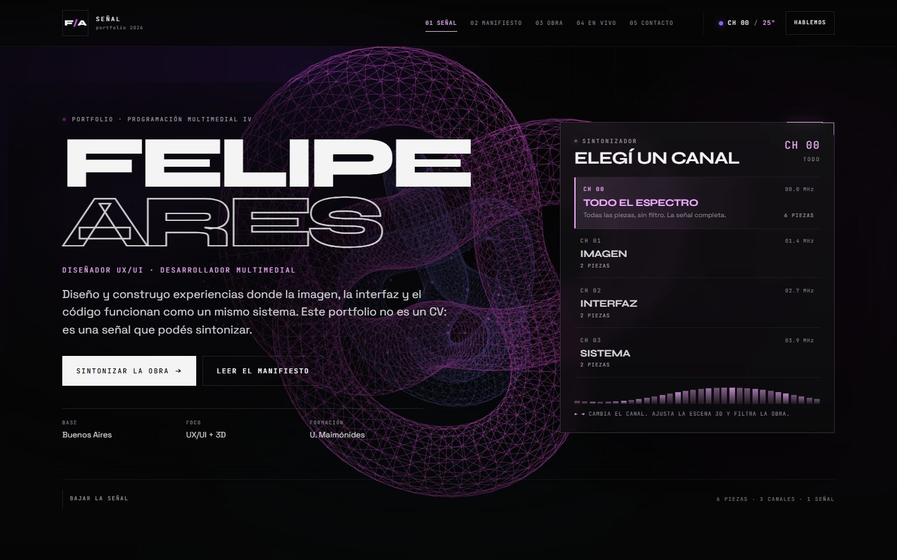

# Felipe Ares — Portfolio 2026

Portfolio interactivo de **Felipe Ares** (diseño UX/UI, desarrollo multimedial y 3D), construido con **Astro**, islas de **React** y **Three.js**.

La pieza se organiza como un entorno que se **sintoniza**: el visitante elige un canal y el sitio responde en tres planos a la vez — cambia la geometría y la paleta de la escena 3D, filtra la obra y actualiza el estado de la cabecera. El clima real de Buenos Aires, obtenido de **Open-Meteo**, entra como contexto y modifica el color, la velocidad y el pulso de la escena.

- Sitio estático de una sola página.
- Cuatro canales: **Todo el espectro**, **Imagen**, **Interfaz** y **Sistema**.
- Seis proyectos, cada uno con ficha completa.
- API pública con estados de carga, éxito, error y vacío.
- Audio ambiental generativo con Web Audio API, sin archivos de audio externos.
- Diseño responsive y accesibilidad verificados en escritorio, tablet y móvil.



---

## Índice

1. [Propuesta y público](#1-propuesta-y-público)
2. [Instalación, desarrollo y build](#2-instalación-desarrollo-y-build)
3. [Stack y justificación](#3-stack-y-justificación)
4. [Componentes con lógica propia](#4-componentes-con-lógica-propia)
5. [API externa: Open-Meteo](#5-api-externa-open-meteo)
6. [Responsive y accesibilidad](#6-responsive-y-accesibilidad)
7. [Rendimiento y build](#7-rendimiento-y-build)
8. [Limitaciones conocidas](#8-limitaciones-conocidas)
9. [Créditos de terceros](#9-créditos-de-terceros)
10. [Registro de uso de IA](#10-registro-de-uso-de-ia)
11. [Documentación del proceso](#11-documentación-del-proceso)

---

## 1. Propuesta y público

**Problema.** Un portfolio de diseño y desarrollo suele mostrarse como una lista de piezas o un CV ilustrado. Ese formato no permite demostrar, en la misma experiencia, las tres competencias que el proyecto declara: criterio visual, construcción de interfaces y código funcionando.

**Propuesta.** Convertir el portfolio en un entorno que se sintoniza. El gesto de elegir un canal no es decorativo: es el mecanismo principal de navegación y filtrado. La escena 3D, la obra y la cabecera comparten el mismo estado, y el clima agrega una capa de contexto real que cambia la pieza sin intervención del usuario.

**Público.**

- Docentes y evaluadores de **Programación Multimedial IV**, que necesitan ver decisiones técnicas defendibles y no solo un resultado visual.
- Reclutadores y clientes de producto, diseño o desarrollo frontend que buscan evidencia de criterio UX/UI, 3D y frontend en un mismo perfil.
- Otros desarrolladores que quieran revisar la integración Astro + React islands + Three.js.

**Objetivos de la pieza.**

1. Demostrar un sistema de diseño propio, no una plantilla.
2. Traducir una identidad visual a interacción, estado y código.
3. Usar una API externa con manejo honesto de los estados de datos.
4. Sostener el rendimiento y la accesibilidad aun con una escena WebGL.

---

## 2. Instalación, desarrollo y build

### Requisitos

- **Node.js 22.x**. El proyecto se construyó y verificó con `v22.14.0`; se recomienda `>=22.19.0` para evitar el aviso de `undici@8` durante la instalación.
- **npm 10.x** (también compatible con pnpm o yarn, aunque los comandos documentados usan npm).

### Comandos

```bash
# 1. Instalar dependencias
npm install

# 2. Levantar el entorno de desarrollo
npm run dev
# http://localhost:4321

# 3. Generar el sitio estático
npm run build
# salida en dist/

# 4. Servir la build localmente
npm run preview
```

No se necesitan variables de entorno ni claves de API. Open-Meteo es público y no requiere autenticación.

### Resultado esperado del build

```text
✓ Completed in ~8s
1 page(s) built
Complete!
```

La build es estática: no hay adapter de servidor ni funciones serverless. El contenido HTML se genera en el build y las islas se hidratan en el navegador.

### Estructura del proyecto

```text
src/
├── components/
│   ├── SiteHeader.astro        # navegación, scrollspy, barra de progreso
│   ├── Hero.astro              # portada + escena + sintonizador
│   ├── Manifesto.astro         # perfil, preguntas, proceso, skills, trayectoria
│   ├── Work.astro              # sección de obra + isla exploradora
│   ├── Live.astro              # clima en vivo + protocolo de datos
│   ├── Contact.astro           # contacto y watermark
│   ├── SiteFooter.astro        # cierre, créditos y navegación
│   └── react/
│       ├── SignalScene.tsx     # escena Three.js reactiva
│       ├── SignalDial.tsx      # sintonizador de canales accesible
│       ├── ProjectExplorer.tsx # filtro, búsqueda y ficha de proyecto
│       ├── WeatherSignal.tsx   # máquina de estados de Open-Meteo
│       └── SignalStatus.tsx    # lectura sincronizada de la cabecera
├── data/profile.ts             # fuente única de contenido y canales
├── layouts/Layout.astro        # head, metadatos, fondo ambiente, skip link
├── lib/weather.ts              # fetch, mapeo WMO, caché y notas de clima
├── pages/index.astro           # composición de la página
├── stores/signal.ts            # estado compartido entre islas (nanostores)
└── styles/
    ├── global.css              # tokens, layout, tipografía, fondo, a11y
    └── islands.css             # estilos de las islas React
```

Toda la copia de contenido personal y de proyectos vive en `src/data/profile.ts`. Cambiar textos, canales o proyectos no requiere tocar los componentes.

---

## 3. Stack y justificación

| Tecnología | Versión | Rol | Por qué |
|---|---:|---|---|
| Astro | 6.4.8 | Framework del sitio | Genera HTML estático y permite aislar el JavaScript interactivo en islas. La mayor parte del sitio no necesita React. |
| React | 19.3.1 | Islas interactivas | La escena, el sintonizador, el explorador y el clima comparten estado y efectos. React + hooks resuelve esa coordinación con poco código. |
| @astrojs/react | 6.0.6 | Integración | Habilita componentes React dentro de Astro con hidratación selectiva. |
| Three.js | 0.187.0 | Motor 3D | WebGL maduro, sin modelos externos; toda la escena se genera por código. |
| @react-three/fiber | 9.8.2 | Puente React ↔ Three.js | Declara geometría, materiales y animación como componentes; evita manejar el ciclo de render a mano. |
| nanostores | 1.5.5 | Estado compartido | Un store mínimo permite que islas separadas (cabecera, escena, obra) reaccionen al mismo canal sin acoplarlas. |
| @nanostores/react | 2.0.1 | Bindings React | `useStore` integra el store con el render de las islas. |
| CSS propio | — | Sistema de diseño | Tokens, grid, tipografía y estados. Se eligió CSS propio en lugar de Tailwind para demostrar control del sistema visual y evitar una capa de utilidades sobre un diseño muy específico. |
| Open-Meteo | API pública | Datos de clima | Sin API key, CORS abierto, respuesta estable y licencia CC BY 4.0. |
| Google Fonts | CDN | Tipografías | Syne (display), Space Grotesk (texto) y JetBrains Mono (datos). |

### Decisiones que se descartaron

- **Next.js**: el portfolio anterior ya era Next. Migrar a Astro permite demostrar el modelo de islas y reducir el JavaScript que no participa de la interacción.
- **Tailwind CSS**: válido, pero el diseño depende de una paleta, tipografía y grillas muy puntuales. Un sistema de tokens propio deja el CSS más legible para la evaluación.
- **Imágenes o modelos 3D externos**: las portadas se generan con CSS y la escena con geometría procedural. No hay dependencias de stock ni assets pesados.
- **Backend propio**: el contacto usa `mailto:` y WhatsApp. No se inventa un formulario que no puede entregar correos en un sitio estático.

---

## 4. Componentes con lógica propia

El requisito era **al menos tres componentes con lógica significativa**. Se implementaron cinco islas React; las tres primeras concentran la interacción principal.

### 4.1 `SignalScene` — escena 3D reactiva

**Archivo:** `src/components/react/SignalScene.tsx`  
**Hidratación:** `client:only="react"` (no tiene sentido renderizar WebGL en el servidor).

**Qué hace.**

- Renderiza una escena de React Three Fiber con geometría procedural: torus knot (canal 0), icosaedro (canal 1), toro (canal 2) y octaedro (canal 3).
- Superpone dos anillos de partículas generados con `Float32Array` y colores interpolados.
- Reacciona al canal (`$channel`) y al clima (`$weather`): paleta, velocidad de rotación y tinte.
- Aplica parallax de puntero solo en dispositivos no móviles y si el usuario no pidió movimiento reducido.
- Reduce cantidad de partículas, segmentos y `dpr` en móvil.
- Pausa el render con `frameloop="never"` cuando la pestaña no está visible.
- Detecta WebGL antes de montar el canvas; si no está disponible, muestra un fallback CSS de tres barras. Un `ErrorBoundary` cubre fallos de render.

**Por qué es significativo.** No es un adorno estático: traduce dos fuentes de estado (canal y clima) a geometría, color y movimiento, y administra límites de rendimiento y accesibilidad.

### 4.2 `SignalDial` — sintonizador de canales

**Archivo:** `src/components/react/SignalDial.tsx`  
**Hidratación:** `client:load` (es la interacción principal de la portada).

**Qué hace.**

- Renderiza los cuatro canales como un `radiogroup` con `role="radio"` y `aria-checked`.
- Navegación completa por teclado: flechas (`← → ↑ ↓`), `Home` y `End`, con foco administrado y `tabIndex` móvil (roving tabindex).
- Escribe el canal en la URL (`?canal=1..3`) con `history.replaceState`, para poder compartir un estado de la pieza.
- Lee el parámetro al montar: un enlace `/?canal=2` abre el sitio en Interfaz.
- Muestra la cantidad de piezas por canal y anuncia el cambio en una región `aria-live`.

**Por qué es significativo.** Es un patrón de selección accesible implementado desde cero, con estado compartido, deep linking y feedback visual/sonoro para lectores de pantalla.

### 4.3 `ProjectExplorer` — filtro, búsqueda y ficha

**Archivo:** `src/components/react/ProjectExplorer.tsx`  
**Hidratación:** `client:visible` (la obra está debajo del pliegue).

**Qué hace.**

- Filtra los seis proyectos según el canal activo usando `projectsForChannel()`.
- Búsqueda en título, subtítulo, categoría, año, descripción y herramientas, con normalización de acentos y mayúsculas (`NFD` + diacríticos).
- Estado vacío real con acciones para limpiar la búsqueda o abrir todo el espectro.
- Abre cada proyecto en un `<dialog>` nativo con foco atrapado por el navegador, cierre con `Esc`, clic en backdrop y navegación anterior/siguiente circular.
- Mantiene el HTML inicial estable (canal 0) y lee el store compartido después de hidratar, para evitar mismatches de hidratación si el usuario sintonizó antes de llegar a la sección.

**Por qué es significativo.** Combina dos criterios de filtrado (canal + texto), estados vacíos, diálogo accesible y sincronización con estado global.

### 4.4 `WeatherSignal` — máquina de estados de la API

**Archivo:** `src/components/react/WeatherSignal.tsx`  
**Hidratación:** `client:idle`.

Implementa los cuatro estados pedidos (`loading`, `success`, `error`, `empty`), timeout, caché, reintento y fallback a la última lectura guardada. Se detalla en la sección 5.

### 4.5 `AmbientEngine` + `SoundControl` — audio generativo

**Archivos:** `src/lib/ambient.ts` (motor), `src/components/react/SoundControl.tsx` (control).  
**Hidratación:** `client:idle` en la cabecera.

- Cuatro voces de osciladores (triángulo + seno desafinado) filtradas por un `BiquadFilterNode` pasa-bajos, con delay realimentado y compresor de salida.
- Cada canal define raíz, acorde, corte de filtro y delay: A2 abierto (CH 00), Cmaj7 (CH 01), Gm7 (CH 02) y F abierto (CH 03).
- Al cambiar de canal, frecuencia, filtro y delay se interpolan con `linearRampToValueAtTime` / `exponentialRampToValueAtTime` en **1.8 s**. El audio nunca se corta.
- Primer clic en el sintonizador: fade-in de **2 s** desde silencio. El botón `SONIDO ON / OFF` silencia y reanuda; `aria-pressed` y la etiqueta accesible reflejan el estado.
- Las barras del sintonizador solo se animan con audio activo (`data-audio`).
- No hay `.mp3`: todo se sintetiza en el navegador. El `AudioContext` se crea con el primer gesto, por la política de autoplay.

**Por qué es significativo.** Suma una capa sensorial sincronizada con el estado del sitio y demuestra Web Audio API, rampas suaves y control accesible de reproducción.

### 4.6 `SignalStatus` — lectura de cabecera

**Archivo:** `src/components/react/SignalStatus.tsx`  
**Hidratación:** `client:idle`.

Muestra `BUE · XX°C` en la cabecera: ubicación de la lectura y temperatura actual, sincronizadas con el resto de las islas. La versión visible es decorativa (`aria-hidden`) y se acompaña de una descripción `sr-only` para lectores de pantalla.

### Componentes Astro destacados

- `SiteHeader.astro`: navegación fija, scrollspy con `IntersectionObserver`, barra de progreso de lectura y menú horizontal desplazable en móvil.
- `Manifesto.astro`: perfil, tres preguntas, proceso, skills y trayectoria; renderiza datos tipados de `profile.ts`.
- `Contact.astro`: contacto directo, estado de disponibilidad y watermark tipográfico.

---

## 5. API externa: Open-Meteo

### Endpoint

```http
GET https://api.open-meteo.com/v1/forecast
  ?latitude=-34.6037
  &longitude=-58.3816
  &current=temperature_2m,relative_humidity_2m,apparent_temperature,is_day,precipitation,weather_code,wind_speed_10m
  &timezone=America%2FArgentina%2FBuenos_Aires
  &forecast_days=1
```

- **Autenticación:** ninguna.
- **Costo:** gratuito para uso no comercial, según las condiciones de Open-Meteo.
- **CORS:** habilitado; la petición se hace desde el navegador.
- **Ubicación:** Buenos Aires (`-34.6037, -58.3816`), zona horaria `America/Argentina/Buenos_Aires`.
- **Implementación:** `src/lib/weather.ts`.

### Por qué Open-Meteo

La consigna pide una API externa real, y el portfolio necesitaba un dato que pudiera **cambiar la experiencia**, no solo mostrarse en un widget. Open-Meteo resuelve tres condiciones:

1. **Sin clave ni registro:** cualquiera puede clonar el repo, correr `npm install && npm run dev` y ver la integración funcionando.
2. **CORS habilitado:** la consulta se hace desde el navegador; no hace falta un backend propio.
3. **Datos atmosféricos de Buenos Aires:** temperatura, humedad, viento, precipitación y código WMO se traducen a paleta, velocidad de rotación y pulso de la escena 3D. El clima de la ciudad donde vivo modifica el entorno en tiempo real.

La integración no es decorativa: `commitWeather()` escribe el estado compartido y la escena, el indicador de la cabecera y la ficha climática reaccionan sin recargar. Cuando la API falla, el sitio lo dice y ofrece reintento.

### Respuesta utilizada (ejemplo abreviado)

```json
{
  "latitude": -34.6037,
  "longitude": -58.3816,
  "timezone": "America/Argentina/Buenos_Aires",
  "current": {
    "time": "2026-11-11T19:00",
    "temperature_2m": 25.1,
    "relative_humidity_2m": 57,
    "apparent_temperature": 26.3,
    "is_day": 1,
    "precipitation": 0,
    "weather_code": 3,
    "wind_speed_10m": 8.4
  }
}
```

Campos normalizados en `WeatherSnapshot`:

| Campo | Tipo | Uso |
|---|---|---|
| `temperature` | number | Temperatura principal, redondeada. |
| `apparent` | number | Sensación térmica. |
| `humidity` | number | Humedad relativa. |
| `wind` | number | Viento en km/h. |
| `precipitation` | number | Precipitación en mm. |
| `isDay` | boolean | Día/noche. |
| `code` | number | Código WMO original. |
| `label` | string | Traducción del código WMO. |
| `mood` | `clear \| cloud \| fog \| rain \| snow \| storm` | Estado que consume la escena 3D. |
| `fetchedAt` | number | Timestamp para la caché. |
| `cached` | boolean | Indica si la lectura viene de `sessionStorage`. |

### Mapeo de clima → escena

| `mood` | Códigos WMO (ejemplos) | Tinte | Velocidad |
|---|---|---:|---:|
| `clear` | 0, 1 | `#8b5cf6` | 1.0 |
| `cloud` | 2, 3 | `#6366f1` | 0.8 |
| `fog` | 45, 48 | `#94a3b8` | 0.45 |
| `rain` | 51–67, 80–82 | `#38bdf8` | 1.55 |
| `snow` | 71–77, 85–86 | `#e0e7ff` | 0.3 |
| `storm` | 95–99 | `#fb7185` | 2.6 |

La paleta del canal define el color primario y el clima define el secundario. Ambos se combinan en la escena y en el indicador de la cabecera.

### Estados de la interfaz

| Estado | Cuándo | Qué ve el usuario |
|---|---|---|
| **Loading** | Primer fetch o reintento sin lectura previa. | Skeleton con barras y texto “Consultando Buenos Aires…”. |
| **Success** | Respuesta válida o caché fresca. | Temperatura, condición, métricas, nota de escena y hora de actualización. |
| **Error** | Red caída, timeout, HTTP no exitoso o sin conexión. | `SIN CONEXIÓN`, explicación y botón **Reintentar**. Si hay caché vieja, se muestra esa lectura con aviso. |
| **Empty** | La API responde 200 pero sin bloque `current` o sin temperatura. | `SIN DATOS` y mensaje de que la API respondió sin datos de clima, sin inventar valores. |
| **Selección** | El visitante cambia de canal en el sintonizador. | El canal filtra la obra, cambia la escena 3D y actualiza la URL con `?canal=N`. |
| **Navegación** | Deep link `?canal=2`, scrollspy o ficha de proyecto. | El estado se restaura desde la URL y el diálogo permite recorrer las piezas sin cerrar. |

Detalles de implementación:

- **Timeout:** `AbortController` + `setTimeout` de **8 segundos**. La petición anterior se aborta si se dispara otra.
- **Caché:** `sessionStorage`, clave `senal:weather:v1`, TTL de **10 minutos**. Se valida la forma del snapshot antes de usarlo.
- **Caché obsoleta:** si el fetch falla y existe una lectura vieja, se muestra con la etiqueta `CACHÉ` y un aviso; no se oculta el error.
- **Conectividad:** si `navigator.onLine` es `false`, se evita la petición y se va directo al fallback.
- **Accesibilidad:** región `aria-live` para anunciar el estado, `role="alert"` en errores, `aria-busy` durante la actualización y botón de reintento real.
- **Efecto en la escena:** `commitWeather()` escribe `$weather` y `$weatherStatus`; `SignalScene` y `SignalStatus` reaccionan sin recargar.

### Verificación manual

```bash
# Respuesta directa de la API
curl "https://api.open-meteo.com/v1/forecast?latitude=-34.6037&longitude=-58.3816&current=temperature_2m,weather_code&timezone=America%2FArgentina%2FBuenos_Aires&forecast_days=1"
```

En la prueba de integración (Chrome headless, 11/11/2026) la API devolvió **25 °C, código 3 (Nublado)** y la interfaz mostró el estado de éxito, la nota “La paleta baja a índigo y el movimiento se vuelve más denso” y el indicador actualizado en la cabecera.

### Límites de la API

- No hay SLA ni clave: es un servicio comunitario. Si cambia el contrato, el estado de error lo hace visible.
- Solo se consulta el clima **actual** de una ciudad.
- Los valores se redondean para la interfaz; no se usan para cálculos científicos.
- La caché es por pestaña (`sessionStorage`), no compartida entre dispositivos.

---

## 6. Responsive y accesibilidad

### Breakpoints y adaptaciones

| Rango | Cambios principales |
|---|---|
| `> 1100px` | Hero a dos columnas (copy + sintonizador), obra a tres columnas, cabecera en una fila. |
| `≤ 1100px` | Obra a dos columnas; columnas del diálogo de proyecto pasan a una. |
| `≤ 980px` | Hero, manifiesto y cabecera pasan a una columna; la navegación ocupa una segunda fila; títulos con interlineado ajustado. |
| `≤ 900px` | Clima y protocolo se apilan; footer reorganizado. |
| `≤ 820px` | Escena más tenue, métricas del clima a dos columnas, contacto a una columna. |
| `≤ 768px` | La escena reduce partículas, segmentos y `dpr`; se desactiva el parallax. |
| `≤ 760px` | Preguntas, proceso, skills y trayectoria a una columna; títulos con `line-height` 1.2. |
| `≤ 640px` | Navegación sin numeración, obra a una columna, búsqueda a ancho completo, diálogo a pantalla completa. |
| `≤ 520px` | Marca compacta, contacto y metadatos reordenados, títulos con escala móvil. |

La navegación móvil conserva los cinco destinos en una fila desplazable, sin scrollbar visible, con áreas táctiles de al menos 34 px de alto. La barra superior mide 119 px en móvil (marca + estado + navegación) y 75 px en escritorio.

### Accesibilidad implementada

- `lang="es"` y jerarquía de encabezados (`h1` → `h2` → `h3`).
- **Skip link** visible al enfocar: “Saltar al contenido”.
- Landmarks semánticos: `header`, `nav`, `main`, `section`, `footer`.
- `:focus-visible` con contorno de alto contraste en todos los controles.
- Sintonizador como `radiogroup` con `aria-checked`, `aria-labelledby`, `aria-describedby` y región `aria-live`.
- Ficha de proyecto con `<dialog>` nativo (foco atrapado, `Esc`, backdrop), `aria-labelledby` y botones con etiquetas explícitas.
- Estados de la API anunciados por `aria-live`; errores con `role="alert"`.
- Escena 3D marcada `aria-hidden="true"` porque es decorativa; el contenido equivalente está en HTML.
- `prefers-reduced-motion`: se detienen rotaciones y animaciones; la escena queda estática.
- `prefers-contrast: more`: se refuerzan líneas, textos secundarios y trazos tipográficos.
- Aviso `noscript`: el contenido principal sigue disponible sin JavaScript.
- Enlaces externos con `rel="noopener noreferrer"`.
- Sin texto incrustado en imágenes: las portadas son CSS y los datos están en HTML.

### Pruebas de pantalla realizadas

| Prueba | Condición | Resultado |
|---|---|---|
| Overflow horizontal | 360 × 800 | 360 = 360. |
| Overflow horizontal | 390 × 844 | `documentElement.scrollWidth` = `clientWidth` = 390. Sin scroll lateral. |
| Overflow horizontal | 521 × 900 | 521 = 521. Títulos de sección sin recorte. |
| Overflow horizontal | 600 × 900 | 600 = 600. |
| Overflow horizontal | 768 × 1024 | 768 = 768. Hero a una columna; obra a dos. |
| Overflow horizontal | 981 × 900 | 981 = 981. Manifiesto a dos columnas con 69 px de separación. |
| Overflow horizontal | 1024 × 900 | 1024 = 1024. |
| Overflow horizontal | 1280 × 900 | 1280 = 1280. |
| Overflow horizontal | 1440 × 900 | 1440 = 1440. Hero a dos columnas. |
| Título de manifiesto | 981–1440 | “PANTALLAS.” no se parte ni invade la columna derecha (≥ 40 px de aire). |
| Título de contacto | 360, 390, 1440 | “¿Hablemos?” entra completo, sin recorte ni scroll lateral. |
| Sintonizador por teclado | `ArrowRight` sobre el canal activo | Cambia a `CH 01`, actualiza `?canal=1` y el estado de la cabecera. |
| Deep link | `/?canal=2` | Abre en Interfaz, muestra 2 de 6 piezas. |
| Filtro por canal | Clic en Imagen | “6 de 6” → “2 de 6 piezas · Imagen”. |
| Ficha de proyecto | Enter sobre una tarjeta | Abre el diálogo; `Esc` cierra y devuelve el foco a la tarjeta. |
| Estado vacío | Búsqueda `zzzz-no-existe` | Aparece “Sin resultados” con acciones de recuperación. |
| Audio al elegir canal | Primer clic en CH 01 | Fade-in de 2 s, botón en `SONIDO ON`, barras del sintonizador animadas. |
| Mute / unmute | Botón `SONIDO` | Salida en 0.4 s, estado `SONIDO OFF`; al reactivar vuelve el canal vigente sin cortes. |
| API | Open-Meteo en vivo | Estado de éxito con 25 °C y código 3; cabecera actualizada. |
| Sin WebGL | Chrome con `--disable-webgl` | Fallback CSS de tres barras, sin errores. |
| Movimiento reducido | `prefers-reduced-motion: reduce` | La escena renderiza sin animación; sin errores. |
| Consola | 390, 768 y 1440 | Sin errores de página ni de consola después de las correcciones. |

Capturas de referencia: [escritorio](docs/desktop-hero.jpg) · [obra en escritorio](docs/desktop-obra.jpg) · [móvil](docs/mobile-hero.jpg) · [clima en móvil](docs/mobile-vivo.jpg).

---

## 7. Rendimiento y build

- **HTML estático** para todo el contenido principal; el JavaScript se limita a las islas.
- **Hidratación selectiva:** `client:only` para WebGL, `client:load` para el sintonizador, `client:idle` para clima y estado, `client:visible` para la obra.
- **Escena acotada:** `dpr` máximo 1.75 en escritorio y 1 en móvil, menos partículas y segmentos en pantallas chicas, pausa al ocultar la pestaña.
- **Sin imágenes de portada:** las tapas y los patrones son CSS, así que no hay descargas de imágenes de proyecto.
- **Fuentes:** Google Fonts con `preconnect`. Es una dependencia externa consciente (ver limitaciones).

Tamaño de la build de referencia (`npm run build`, 11/11/2026):

| Archivo | Tamaño |
|---|---:|
| `dist/_astro/SignalScene.*.js` | ≈ 914 KB (incluye Three.js) |
| `dist/_astro/client.*.js` | ≈ 206 KB |
| `dist/_astro/index.*.css` | ≈ 54 KB |
| `dist/index.html` | ≈ 42 KB |
| **Total `dist/`** | **≈ 1.25 MB** |

El build emite un aviso de Vite porque el chunk de la escena supera los 500 KB. Es esperable por el peso de Three.js y está documentado como limitación. El resto de la página no depende de ese chunk para renderizar.

---

## 8. Limitaciones conocidas

1. **Peso de la escena 3D.** Three.js + R3F producen un chunk de ≈ 914 KB. Se mitigó con carga diferida, `dpr` acotado y pausa por visibilidad, pero sigue siendo el costo principal del sitio. Una entrega futura podría dividir la escena o evaluar un render WebGL más liviano.
2. **Dependencia de Open-Meteo.** Sin red o con el servicio caído, el sitio muestra error o caché; no hay datos propios. La escena cae al modo `clear` por defecto.
3. **Una sola ciudad.** El clima está fijado a Buenos Aires por decisión de diseño; no hay geolocalización.
4. **Sin backend.** El contacto usa `mailto:`, WhatsApp y LinkedIn. No hay formulario con persistencia ni envío de correo desde el servidor.
5. **Contenido estático.** Los proyectos y textos viven en `profile.ts`; no hay CMS ni panel de edición.
6. **Sin tests automatizados.** La verificación fue manual/asistida con Chrome headless y Playwright; no hay suite de unit tests ni E2E versionada en el repositorio.
7. **Una sola página y un solo idioma.** No hay i18n ni rutas adicionales.
8. **Tipografías externas.** Google Fonts es un CDN de terceros; si falla, el sitio usa fallbacks del sistema.
9. **Metadatos sociales incompletos.** Hay OG/Twitter básicos, pero no imagen Open Graph dedicada.
10. **Dominio de ejemplo.** `astro.config.mjs` usa `https://senal-felipe.vercel.app` como `site`; debe reemplazarse por el dominio real antes de publicar.
11. **Audio y gesto del usuario.** Por la política de autoplay, el audio solo puede iniciarse con un clic o una tecla. No hay pista pregrabada: si el navegador no soporta Web Audio API, el control queda deshabilitado.

---

## 9. Créditos de terceros

| Recurso | Uso | Licencia / condición |
|---|---|---|
| [Astro](https://astro.build/) | Framework del sitio | MIT |
| [React](https://react.dev/) | Islas interactivas | MIT |
| [Three.js](https://threejs.org/) | Motor 3D | MIT |
| [@react-three/fiber](https://github.com/pmndrs/react-three-fiber) | Render 3D declarativo | MIT |
| [nanostores](https://github.com/nanostores/nanostores) | Estado compartido | MIT |
| [Open-Meteo](https://open-meteo.com/) | Datos meteorológicos | CC BY 4.0; atribución en la interfaz y en este documento |
| [Syne](https://fonts.google.com/specimen/Syne) | Tipografía display | SIL Open Font License 1.1 |
| [Space Grotesk](https://fonts.google.com/specimen/Space+Grotesk) | Tipografía de texto | SIL Open Font License 1.1 |
| [JetBrains Mono](https://fonts.google.com/specimen/JetBrains+Mono) | Tipografía monoespaciada | SIL Open Font License 1.1 |

**Sobre la referencia.** La identidad visual, los datos personales y la base de la escena 3D provienen de un portfolio anterior del propio autor (`felipe-portfolio-next`). No se usó una plantilla de terceros. Se descartaron sus imágenes de stock, el toggle bilingüe y varios patrones específicos de Next.js; la versión actual es una migración y reinterpretación, no una copia.

**Sin recursos externos en la escena.** No hay modelos `.glb`, texturas descargadas ni imágenes de proyecto. Toda la geometría y las portadas se generan con código y CSS.

---

## 10. Registro de uso de IA

Este proyecto se desarrolló con un asistente de IA integrado en **OpenCode** como herramienta de apoyo. El criterio, las decisiones de producto y la validación final fueron del autor. Registro honesto:

### Qué se usó para

- Scaffolding inicial de Astro y configuración de la integración React.
- Migración y adaptación de contenido desde el portfolio anterior a `src/data/profile.ts`.
- Borradores de la escena R3F, el sintonizador, el explorador y la máquina de estados del clima.
- Redacción de estilos y ajustes responsive.
- Ejecución de pruebas de navegador con Playwright y lectura de capturas.
- Borradores de este README y de `PROCESO.md`.

### Qué se decidió y verificó humanamente

- Concepto de canales, sintonizador y relación entre obra, escena y cabecera.
- Elección de Open-Meteo y definición de sus estados, caché y timeout.
- Criterio de diseño: paleta, tipografías, densidad, tono de la copia.
- Revisión de cada estado en el navegador: éxito, error, vacío, filtro, diálogo, teclado, móvil y escritorio.
- Corrección de errores detectados en las pruebas, no aceptados a ciegas.

### Errores reales detectados y corregidos durante el proceso

1. **Desborde horizontal en móvil.** El título de contacto medía 499 px a 390 px de viewport. Se redujo la escala y se verificó que el ancho del documento coincidiera con el viewport.
2. **Títulos superpuestos.** Syne tiene una altura de mayúscula muy grande; `line-height: 0.92` hacía que las líneas se tocaran en móvil. Se ajustó a `1.2` en esa escala y se verificó con capturas por elemento.
3. **Marca “F/A” apilada.** El contenedor usaba `display: grid`, por lo que los tres nodos de texto se convertían en tres filas. Se cambió a `flex`.
4. **Mismatch de hidratación.** Si el usuario cambiaba de canal antes de que `ProjectExplorer` o `SignalStatus` hidrataran, React reportaba el error #418. Se inicializó el HTML con el estado por defecto y se leyó el store después del montaje.
5. **Navegación móvil cortada.** “Contacto” quedaba fuera de la fila desplazable. Se ocultaron los números de sección en móvil y se ajustó la tipografía.

### Lo que la IA no hizo

- No inventó experiencia laboral, proyectos ni datos de contacto.
- No eligió el concepto ni la dirección visual sin revisión.
- No se aceptaron resultados sin build, prueba en navegador y revisión de capturas.

### Transparencia sobre el alcance

La IA acelera la escritura y la exploración, pero no garantiza corrección. Cada afirmación técnica de este README se contrastó con el código y con pruebas ejecutadas. Los enlaces, datos y estados descritos existen en el repositorio.

---

## 11. Documentación del proceso

El detalle de problema, alternativas, evolución, pruebas de pantalla, dificultades y trabajo pendiente está en **[PROCESO.md](PROCESO.md)**.

---

**Felipe Ares** · Buenos Aires, Argentina · 2026  
`felipearespacheco@gmail.com` · [LinkedIn](https://www.linkedin.com/in/felipejarespacheco/) · [WhatsApp](https://wa.me/5491134206387)
